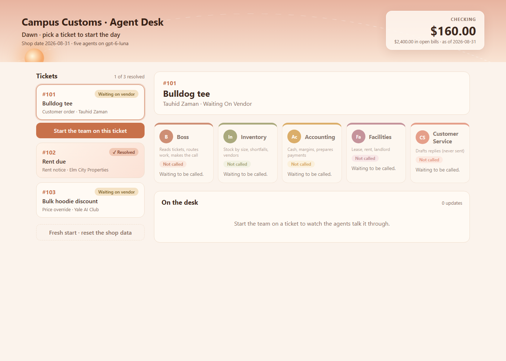
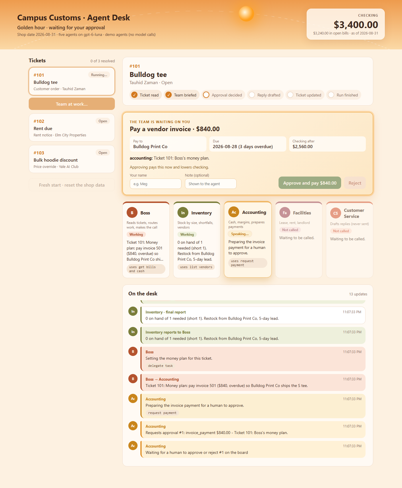
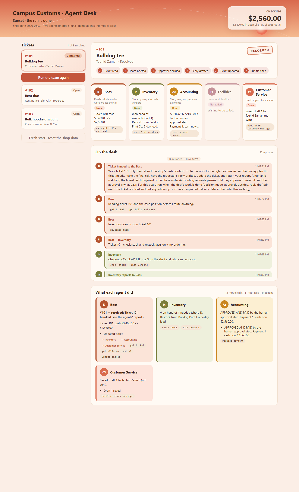
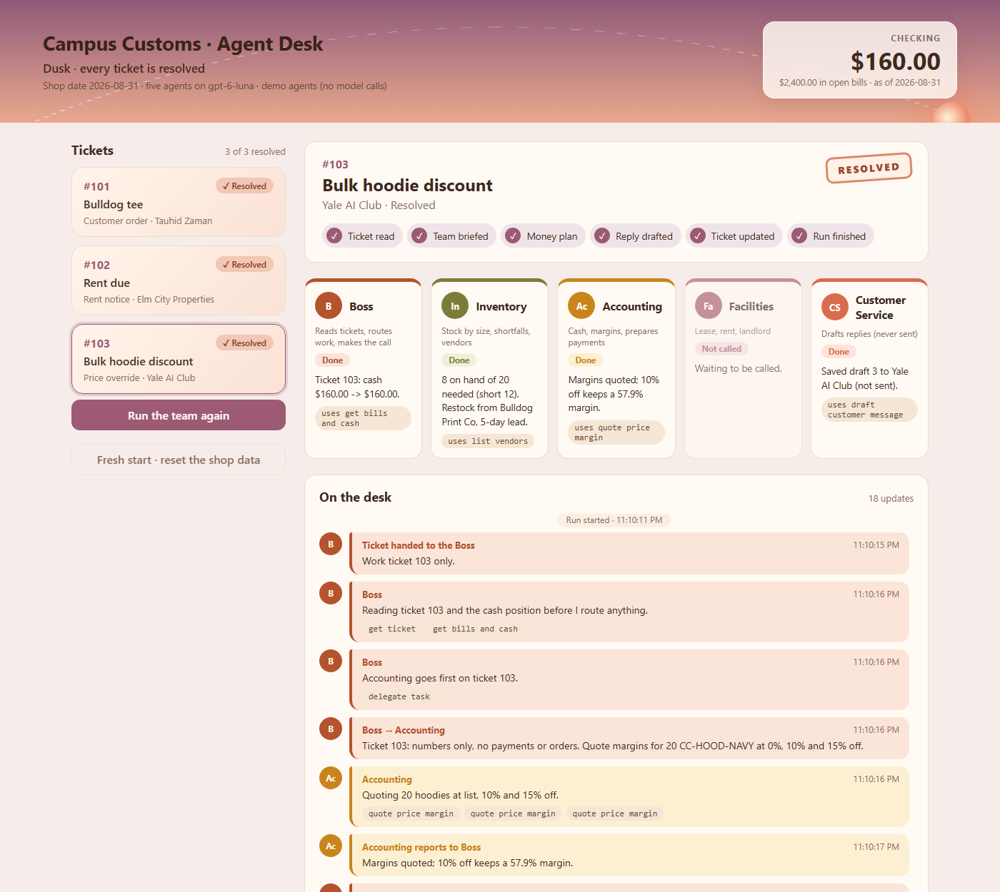

# Agent Desk: dashboard design

The board in `frontend/` (React + Vite + TypeScript). It talks to the FastAPI backend at `http://localhost:8000` (`frontend/src/config.ts`), and the backend allows the Vite origin `http://localhost:5173` through CORS. Start it with `npm run dev` in `frontend/`.

| Dawn (idle) | Golden hour (waiting on you) |
|---|---|
|  |  |
| **Sunset (run done)** | **Dusk (all resolved)** |
|  |  |

*The golden, sunset and dusk screenshots come from demo mode, on a throwaway copy of the database (see the end of this doc).*

## Layout

```
┌───────────────────────── sky header: title · phase · sun on its arc ─────────────── Checking $ ─┐
├──────────────┬──────────────────────────────────────────────────────────────────────────────────┤
│ Tickets      │ Selected ticket: subject · requester · RESOLVED stamp · progress steps           │
│  #101  pill  │ Approval card (only when the team needs you)                                     │
│  #102  pill  │ Five agent cards in one row: who they are · status · latest line · tool          │
│  #103  pill  │ "On the desk": the conversation, newest at the bottom                            │
│  [Start]     │ "What each agent did": per-agent summary once the run ends                       │
│  Fresh start │                                                                                  │
└──────────────┴──────────────────────────────────────────────────────────────────────────────────┘
```

- **Two columns.** The tickets stay pinned on the left, and the work on the right reads top to bottom in the order it happens: what the ticket is, what needs your decision, who is working, what they are saying, and what they did. You never have to hunt sideways.
- **One action per place.** Starting a run happens on the selected ticket card. Approving happens on the approval card. Resetting is a quiet dashed button at the bottom. Destructive or money-moving actions are never next to each other.
- **The approval card sits above the agents**, not in a corner or a pop-up. When the team is waiting, that card is the most important thing on the page, so it gets the top of the workspace and a glowing amber border.
- **Progress steps** sit on the ticket: Ticket read → Team briefed → Money plan or Approval decided → Reply drafted → Ticket updated → Run finished. You can see at a glance how far the run has got without reading the conversation.

## Warm colors that move from sunrise to sunset

The whole page shares one palette that changes with the run's phase (`frontend/src/sky.ts`). The header sky gradient, the sun, the page tint and the accent color all fade over about a second (CSS transitions), so changes feel calm, not flashy.

| Phase | When | Sky | Feel |
|---|---|---|---|
| Dawn | nothing running | soft peach to cream; sun just above the left horizon | quiet, ready |
| Sunrise | the team has just started | apricot to light gold; sun rising | waking up |
| Midday | agents working | warm yellow; sun high | busy but bright |
| Golden hour | the run is paused for your approval | deep amber; sun holds high | "your turn", warm not alarming |
| Sunset | the run finished | coral to rose; sun at the right horizon | done for this ticket |
| Dusk | all three tickets resolved | plum to rose; sun setting | the day's work is complete |

**Why:**
- **Relaxing:** warm hues (peach, apricot, terracotta, rose, plum) on cream cards are easy on the eyes for a board you leave open.
- **Readable:** the sky only colors the header band and the page tint. Every piece of text sits on near-white cards (`#fffaf4`) in dark brown (`#3e2a20`), so contrast stays high in every phase.
- **Status at a glance:** the sun's position and the phase line ("Golden hour · waiting for your approval") tell you where things stand without reading anything else.

## How the agents read differently

Each agent has a fixed identity (`frontend/src/agents.ts`), used the same way everywhere: agent cards, conversation bubbles and the summary.

| Agent | Monogram | Color | Role line |
|---|---|---|---|
| Boss | B | terracotta `#b4532e` | Reads tickets, routes work, makes the call |
| Inventory | In | olive `#7a7d3a` | Stock by size, shortfalls, vendors |
| Accounting | Ac | amber `#c9851c` | Cash, margins, prepares payments |
| Facilities | Fa | dusty rose `#a55a6a` | Lease, rent, landlord |
| Customer Service | CS | coral `#d96c4f` | Drafts replies (never sent) |
| You (human) | You | plum `#6b4a6e` | Approves payments and orders |

- **Color, monogram and position.** Each agent has a colored top border and avatar, its own spot in the five-card row, and a monogram, so you can tell them apart even without color (for color-blind users).
- **Status pill on each card:** *Not called* (the card is faded), *Working*, *Speaking…* (the agent that acted last lifts and glows), *Waiting on you* (amber), *Done*.
- **Conversation bubbles** are tinted in the speaker's color, with a left stripe and avatar, like a group chat.
  - **Hand-offs** read as "Boss → Inventory".
  - **Reports back** read as "Inventory reports to Boss".
  - **Tools** an agent used show as small monospace chips (`check stock`, `request payment`), so *saying* and *doing* look different.
  - **Approval requests** are amber, **decisions and payments** green, and **errors** red-pink, so the money moments stand out in the scroll.
- **Noise is trimmed.** Raw tool calls and successful tool results stay in the audit trail. The board shows what agents *said*, with their tools as chips, which keeps the conversation short enough to follow live.

## How resolved tickets show up

- **Ticket list:** the status pill becomes a peach **"✓ Resolved"**, the card gets a soft sunset gradient, and the header counts "*n* of 3 resolved".
- **Ticket header:** a tilted **RESOLVED** stamp in terracotta, like a rubber stamp on a paper ticket, and every progress step turns into a check.
- **The sky:** the run finishing turns it to **sunset**. When all three tickets are resolved, it turns to **dusk**.
- **Where "resolved" comes from:** the database, not the browser. When a board run finishes, the Boss marks the ticket `resolved` through the MCP `update_ticket` tool, with any follow-up such as an expected delivery date in the note. The board reads that back from `GET /tickets`, so a page refresh shows the same thing.

## How cash shows up

- **Always visible:** checking sits on a frosted card at the top right of the sky header, in large tabular numbers, with open bills underneath. It is the one number that matters across all tickets, so it's always on screen.
- **It drops when you approve a payment:** the balance updates within about a second (the board refreshes every 1.2 s during a run). A red **"−$840.00"** badge appears for a few seconds, and the card gives a small nudge. Purchase orders don't change cash, and the card says so.
- **Before you decide:** the approval card shows **"Checking after"**, the balance once you approve. It turns red if it would go below zero, though the backend refuses that anyway. For purchase orders it shows cash today and any shortfall.
- **The approve button names the money:** "Approve and pay $840.00". The note under it says approving pays now and lowers checking.

## How approvals work on the board

- **Paused, not pending.** When Accounting prepares a payment or purchase order, the run *pauses* (`waiting_for_approval` in `GET /runs/current`) and the amber approval card appears.
- **Your click is the payment.** Approving calls `POST /approvals/{id}/approve`, which records your name and pays. Rejecting records the rejection, and nothing moves.
- **Then the run continues.** The agent gets the outcome and the run carries on to the reply and the resolved ticket.
- **Your name is remembered** in the browser, and it is what ends up in `payments.approved_by`.

## What each agent did

When a run ends, `GET /runs/{run_id}/summary` builds one card per agent, in that agent's color. Each card shows:
- the agent's own one-line summary (and the Boss's decision per ticket)
- its actions
- who it handed work to
- the tools it used, with counts

The heading shows the run's total model calls, tool calls and tokens.

## Accessibility and comfort

- High-contrast text on light cards in every phase. Color is never the only signal: there are always labels like "Resolved", "Waiting on you" and "Approve and pay".
- Keyboard focus rings use the phase's accent color. The phase line, cash and toasts are `aria-live`, so screen readers hear changes.
- On a narrow window the layout drops to one column, and the agent row goes from five to three per row.

## Demo mode (for trying the board for free)

`CAMPUS_CUSTOMS_DEMO=1` makes the backend use scripted stand-in agents instead of gpt-6-luna (`backend/demo.py`). Everything else is real:
- **MCP and the database:** the agents make real MCP tool calls and the database is really written.
- **Approvals:** real approval pauses, and the approve route really pays.
- **Records:** the audit trail and every route work as normal.

The screenshots above came from a demo run on a throwaway copy of the database, so the real working database was not touched.
